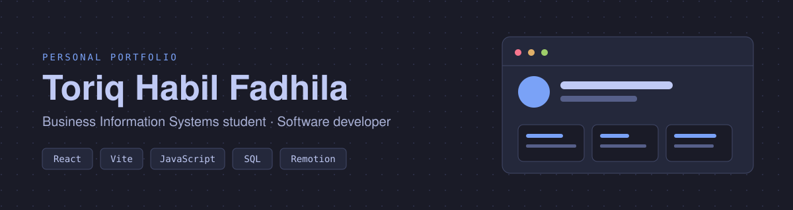
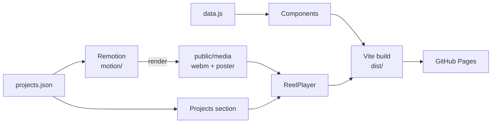
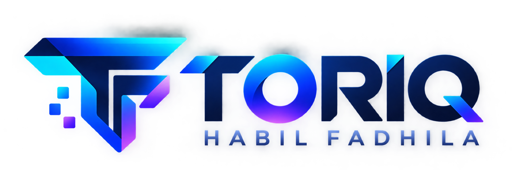

<div align="center">



<br />

[](https://react.dev/)
[](https://vite.dev/)
[](https://developer.mozilla.org/en-US/docs/Web/JavaScript)
[](https://eslint.org/)
[](https://toriqqhabilfadhilaa.github.io/)

[**Live site**](https://hitoriqq.github.io/Portofolio/) ·
[**LinkedIn**](https://www.linkedin.com/in/toriqhabilfadhila21/) ·
[**Getting started**](#getting-started) ·
[**Architecture**](#architecture)

</div>

## Overview

A personal portofolio built with React and Vite. It combines software development with a business-systems perspective: each project is presented as a problem, a solution, and the value it was meant to deliver, not only a list of technologies.

Focus areas: system analysis and design, business process modeling, database design and SQL, web application development, and business analytics.

## Features

| Feature | Details |
| --- | --- |
| Single-page layout | Hero, About, Skills, Projects, Journey, Contact |
| Dark and light theme | Driven by design tokens, switchable from the header |
| Active section tracking | Navigation highlights the section in view |
| Scroll reveals | Elements animate in once, and respect `prefers-reduced-motion` |
| Project reels | Short rendered clips of each project in a custom player |
| Responsive | Desktop, tablet, and mobile |

## Architecture

Content is kept separate from components, and project text is shared between the site and the reel renderer so they never drift apart.



## Tech Stack

| Area | Tools |
| --- | --- |
| UI | React 19, JavaScript (ES6+), HTML5, CSS3 |
| Build | Vite 7 |
| Motion | CSS transitions in the app, Remotion for reels only (not bundled into the app) |
| Quality | ESLint |
| Workflow | Git, GitHub, GitHub Pages, VS Code |

## Getting Started

Requires Node.js 20.19+ (the minimum for Vite 7).

```bash
git clone https://github.com/HiToriqq/Portofolio.git
cd Portofolio
npm install
npm run dev
```

The dev server runs at `http://localhost:5173`.

### Scripts

| Command | Description |
| --- | --- |
| `npm run dev` | Start the dev server with hot module replacement |
| `npm run build` | Create an optimized production build in `dist/` |
| `npm run preview` | Serve the production build locally |
| `npm run lint` | Run ESLint |

Before pushing, run `npm run lint` and `npm run build`.

## Project Structure

```text
Portofolio/
├── docs/                 Banner and preview images used by this README
├── public/
│   └── media/            Rendered reels (webm) and posters
├── src/
│   ├── content/          data.js (copy and assets), projects.json (project text, shared with Remotion)
│   ├── styles/           tokens.css, base.css, motion.css, components.css
│   ├── hooks/            useTheme, useInView, useActiveSection, useReducedMotion
│   ├── components/       Header, Hero, About, Skills, Projects, ReelPlayer, Journey, Contact, Footer
│   ├── App.jsx
│   └── main.jsx
├── motion/               Remotion compositions (separate from the app, see motion/README.md)
├── eslint.config.js
├── index.html
├── vite.config.js
└── package.json
```

Text and project details live in `src/content/`, so they can change without touching components.

## Motion

In-app animation is plain CSS. `tokens.css` defines one easing curve, one travel distance, and three durations, so every transition feels consistent. All of it is disabled when the user prefers reduced motion.

Remotion only renders the project reels. Its output goes to `public/media/`, and nothing from it is bundled into the app.

## Deployment

The site is a static build deployed to GitHub Pages.

```bash
npm run build
```

Publish the contents of `dist/`. If the site is served from a project repository (for example `user.github.io/Portofolio`), set `base: '/Portofolio/'` in `vite.config.js`. A user site served from the domain root needs no `base`.

## Roadmap

| Item | Status |
| --- | --- |
| Detailed project pages | Planned |
| Project filtering | Planned |
| Downloadable CV | Planned |
| SEO and Open Graph metadata | Planned |
| Accessibility audit | Planned |
| Image optimization | Planned |

Update the status column as items move to *In progress* or *Done*.

## Contact

- Portofolio: [hitoriqq.github.io](https://hitoriqq.github.io/Portofolio/)
- Source: [github.com/HiToriqq/Portofolio](https://github.com/HiToriqq/Portofolio)
- LinkedIn: [toriqhabilfadhila21](https://www.linkedin.com/in/toriqhabilfadhila21/)

## License

Personal portofolio, shared for educational purposes. Feel free to take inspiration from it, but please do not copy the content or design as your own.

<p align="center">
  
</p>

<p align="center">
  Built with React and Vite by <strong>Toriq Habil Fadhila</strong>
</p>